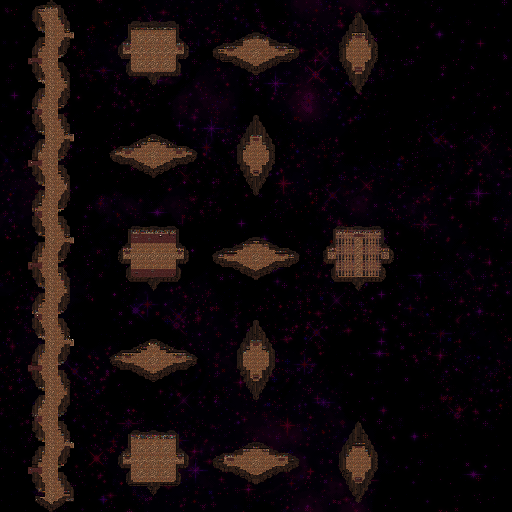
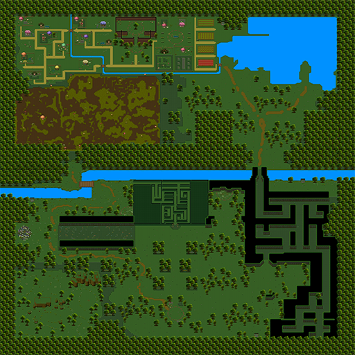

# Vampire Survivors 地图设计专题

> 研究范围：当前安装包中的 24 个本体 `STAGE_DATA` 配置，未合并 DLC JSON。
> 图片范围：24 张关卡图标、24 张图鉴背景、Astral Stair 与 Westwoods 两张详细地图。
> 说明：图鉴背景用于视觉预览，不等同于完整碰撞地图；详细地图图片与 Tiled 结构分析分开说明。

## 0. 地图不是一张背景，而是六层内容

```text
关卡选择信息：名称、图标、顺序、解锁和隐藏标记
空间结构：Tileset、地图 Key、循环方式、尺寸和边界
美术表现：背景、色调、移动背景、光照和昼夜
手工内容：出生点、武器、遗物、棺材、商人、传送器等对象层
动态规则：分钟敌群、Boss、事件、可破坏物和模式修正
导航界面：详细地图、缩放、玩家/物品/事件图标
```

当前本体共有：

- **24 个关卡配置**；
- **535 条逐分钟配置**；
- **17 个声明 `isTiling=true` 的关卡**；
- **2 张可导出的详细地图图片**。

配套文件：

- `vampire-survivors-catalog/stages.csv`：关卡摘要；
- `vampire-survivors-catalog/stage-schedules.csv`：全部逐分钟配置；
- `vampire-survivors-catalog/stage-unlocks.csv`：地图解锁条件；
- 图鉴中的“地图设计”栏目：图片与详情。

---

## 1. 循环地图、固定地图与特殊结构

### 1.1 `isTiling` 只是空间规则之一

`tileset` 中可以出现：

- `mapKey / mapPath`
- `setKey / setPath`
- `isTiling`
- `SizeX / SizeY`
- `isHorizontalRoad`
- `minTreasureX / maxTreasureX / minTreasureY / maxTreasureY`
- `detailsPath / detailsTexture / mapRelic`

代表结构：

| 关卡 | TimeLimit | 循环声明 | 尺寸（原始单位） | 特殊结构 |
|---|---:|---|---|---|
| Mad Forest | 1800 秒 | true | 未单独声明 | 基础连续地图 |
| Holy Forbidden | 120 秒 | true | 8192×1024 | 特殊短挑战 |
| Whiteout | 1200 秒 | true | 4096×4096 | 特殊视觉与模式 |
| The Coop | 1200 秒 | true | 1024×512 | 另有宝物边界 |
| Westwoods | 1200 秒 | true | 10240×10240 | 详细地图与特殊区域 |
| Bat Country | 1200 秒 | true | 2048×2048 | 逆森林变体 |
| Astral Stair | 1200 秒 | false | 10240×10240 | 固定地图与详细地图 |
| Carlo Cart | 900 秒 | true | 2432×4096 | `isHorizontalRoad=true` |
| Devil Room | 1800 秒 | false | 未单独声明 | 特殊边界与模式 |
| Mazerella | 1200 秒 | 未声明 | 未单独声明 | 复用 Plant 图块 |

**有 SizeX/SizeY 不代表只能固定游玩。** 循环地图同样需要知道单块尺寸、重复中心、物理边界和包裹坐标。

**没有声明 isTiling 也不能武断归类。** 报告和图鉴保留“未声明”，避免用默认值替代真实配置。

### 1.2 Tiling 的实际工作流

`TilingTileset.GenerateMaps()` 已验证会：

- 从 `TilesetFactory` 取得支持 prefab；
- 生成和放置地图；
- 处理 Inverse/Tint、Sorting 和渲染；
- 构建 Phaser Tilemap 与碰撞；
- 处理地图使用的角色与对象层。

`ProcessTiling()` 则根据玩家和多人状态：

- 更新横向/纵向 tiling；
- 处理传送后的地图位置；
- 更新 Phaser Tilemap 边界；
- 保持地图和物理边界同步。

相关查询还包括：

- `IsPointWithinCollisionLayer`
- `IsPointWithinCollisionLayerWrapped`
- `HasEmptyFloorTile`
- `GetSpawningLayerTile`

因此连续地图不是简单背景循环，而是：

```text
图块循环 + 碰撞边界 + 合法落点 + 对象重定位 + 包裹坐标
```

这套证据不能直接证明项目使用了完整的 Floating Origin 浮点精度方案，两者不要混淆。

### 1.3 特殊道路不是普通 Tiling

Carlo Cart 使用：

```text
isHorizontalRoad = true
SizeX = 2432
SizeY = 4096
isRacingStage = true
```

`TilingTileset` 另有 `MoveTilesetForHorizontalRoad(...)`，`BackgroundManager` 也提供竞速边界与 `ContainWithinRacingBounds(...)`。

这说明地图类型可以拥有独立的移动和限制规则，不必强塞进普通“玩家自由移动、地图围绕玩家循环”的模型。

---

## 2. Tiled 对象层：手工路线与动态刷怪并存

### 2.1 地图中手工配置的内容

`HandleCustomScriptProperties(...)` 和对象层接口显示，地图可以包含：

- `SetPlayerStartFromSuperObject`：出生点；
- `SpawnWeaponAt`：地面武器；
- `SpawnItemAt`：物品；
- `SpawnRelicAt`：遗物；
- `SpawnYellowAt`：黄色指引内容；
- `SpawnArcanaChestAt`：特殊宝箱；
- `SpawnCoffin`：棺材角色；
- `SpawnCustomMerchant` / `SpawnAdventureMerchant`：商人；
- `SpawnTextPickup`：文本物件；
- `GetMoongateData`：月门；
- `LinkTeleporters` / `MakeTeleporters`：传送器；
- `SaveBatDragonSpawnLocation`：特殊 Boss 位置。

`HandleArcadePhysics(...)` 会根据地图层建立碰撞，而不是只拿背景图做装饰。

### 2.2 为什么这层很重要

如果所有内容都随机生成，地图只有“地形皮肤”，缺少可学习的路线。手工对象层让设计者可以安排：

- 玩家首先看到什么；
- 哪些资源值得绕路；
- 哪个区域适合风险回报；
- 哪些固定目标能形成地图记忆；
- 哪些传送关系改变路线选择。

随后 `Stage` 再执行分钟敌群、Boss 和事件，形成：

```text
固定地标与路线学习
+ 动态压力与资源消耗
```

### 2.3 对 Robber&Dungeon 的启示

你的“被精英抢走的武器”属于**唯一目标物件**，比 VS 普通拾取物更依赖地图表达：

- 地面武器位置要可读；
- 精英移动后，玩家需要知道武器去了哪里；
- 地图边界不能让唯一武器永久不可达；
- 传送和地图循环不能复制武器或让它失踪；
- 地图 UI 应优先标记唯一目标，而不是平均显示所有物品。

---

## 3. 背景与图块复用：预览相同不等于地图相同

### 3.1 同图块，不同玩法

几个典型例子：

**Forest / EX_LYCAEUM**

- 都使用 `ForestTexturePacked` 和 `mapKey=Forest`；
- Forest 声明 `isTiling=true`；
- EX_LYCAEUM 声明 `isTiling=false`，TimeLimit 也改为 1200 秒。

**Warehouse / Carlo Cart / Laborratory / Mazerella**

- 都可以复用 `PlantTexturePacked` 和 `mapKey=Plant`；
- Carlo Cart 改为横向道路；
- Laborratory 使用另一套时长与模式；
- Mazerella 的循环字段未声明，并拥有自己的模式修正。

**Chapel / Holy Forbidden**

- 都使用 Chapel 图块体系；
- Holy Forbidden 使用 `Stage5wip`，TimeLimit 只有 120 秒，形成独立挑战。

### 3.2 背景复用也需要单独理解

`background_forest.png` 被多个关卡作为图鉴背景复用，包括 Forest、Il Molise、Green Acres、Boss Rash、The Coop、Bat Country。

所以：

- 图鉴背景是视觉代表，不是唯一地图 ID；
- 同一背景不代表相同碰撞、出生点或敌群；
- `background.texture`、`movingBackground`、`BGTextureName` 与 Tileset 是不同层；
- Inverse 的色调变化也不等于复制一张新地图。


---

## 4. 时间与模式修正：地图是玩法规则的载体

### 4.1 时长本身就是一种地图类型

| TimeLimit | 代表关卡 | 设计意义 |
|---:|---|---|
| 120 秒 | Holy Forbidden | 短挑战、特殊规则 |
| 900 秒 | Il Molise、Moongolow、Boss Rash、Carlo Cart | 15 分钟紧凑局 |
| 1200 秒 | Whiteout、Lycaeum、Coop、Space 54、Westwoods、Astral Stair 等 | 20 分钟标准变体 |
| 1800 秒 | Forest、Library、Warehouse、Tower、Chapel、Green Acres、Bone Zone、Devil Room | 30 分钟完整曲线 |
| 5940 秒 | Eudaimonia M. | 99 分钟特殊模式 |

分钟配置条数不总是等于 `TimeLimit / 60`，因此不能只用时长推断全部脚本和事件。

### 4.2 基础、Hyper、Inverse 是三层配置

`StageData` 同时包含：

- `mods`
- `hyper`
- `inverse`

常见修正包括：

- 玩家/敌人/弹道速度；
- 金币与经验倍率；
- 敌人生命倍率；
- Luck；
- 初始生成数；
- `TimeMods.hpPerMinute / speedPerMinute`；
- 色调与解锁标记。

代表差异：

**Bone Zone**

- 基础金币倍率 1.5；
- `hpPerMinute=0.15`；
- `speedPerMinute=0.025`；
- 难度不仅来自敌种，还来自明确的分钟成长。

**Whiteout Hyper**

- 玩家速度 0.65；
- 敌人速度 0.1；
- 金币倍率 0.25；
- 初始生成数 10；
- 与基础敌人速度 0.9 形成强烈对比。

**The Coop**

- `XPBonus=0.35`；
- `hpPerMinute=0.25`；
- 具有 1024×512 尺寸与额外宝物边界。

**Forest Hyper**

- 玩家和敌人速度 0.9；
- 弹道速度 0.25；
- 金币倍率 0.5；
- 初始生成数 15。

### 4.3 模式不是单纯“加血加攻”

这些修正确实会改变：

- 行走和躲避空间；
- 敌群压迫速度；
- 资源收益；
- 构筑成型速度；
- 同一地图的熟悉路线是否仍然成立。

**设计启示：** 变体应优先复用空间与内容，再调整有辨识度的规则，而不是复制整张地图后逐项修改。

---

## 5. 解锁设计：地图同时承担进度引导

### 5.1 基础解锁链

| 成就 | 解锁地图 | 条件 |
|---|---|---|
| ReachLV20InMadForest | LIBRARY | 在 Forest 达到 20 级 |
| ReachLV40InLibrary | WAREHOUSE | 在 Library 达到 40 级 |
| ReachLV60InDairyPlant | TOWER | 在 Warehouse 达到 60 级 |
| FindYellowSignS5 | CHAPEL | 在 Tower 达到 80 级 |

这条链让新地图既是新内容，也是玩家掌握旧地图后的奖励。

### 5.2 逆模式连接变体

逆模式成就会解锁新的地图变体：

- Inverse Forest → Bat Country；
- Inverse Library → Astral Stair；
- Inverse Warehouse → Mazerella；
- Inverse Tower → Tiny Bridge。

这些成就还要求 `RELIC_MIRROR`，说明变体解锁不仅看等级，也依赖特定遗物。

### 5.3 物品积累也能解锁地图

示例：

- 20 个 Orologion + RELIC_MAP → Whiteout；
- 50 个 Vacuum + RELIC_MAP → EX_LYCAEUM；
- 33 个 Rosary + RELIC_MAP → Laborratory；
- 500 个 Floor Chicken + RELIC_MAP → The Coop。

这把“地图解锁”与“玩家行为”连接起来：探索物品、挑战逆模式、积累资源，都会变成新的空间内容。

---

## 6. 详细地图与地图 UI

### 6.1 详细地图是独立可解锁内容

Astral Stair 和 Westwoods 的 Tileset 中包含：

- `detailsPath`
- `detailsTexture`
- `mapRelic`

对应：

- `RELIC_MAP_AS` → Astral Stair 详细地图；
- `RELIC_MAP_FS` → Westwoods 详细地图。

这意味着详细地图不是每一关都免费提供的默认信息，而是一种可获得的导航能力。





### 6.2 MapManager 负责的信息聚合

`MapManager` 包含：

- `InitMultiMaps` / `InitDetailedMap`；
- 网格与背景；
- 玩家与多人颜色图标；
- 小物品、场景物品、宝箱；
- 地图 Token 和事件目标；
- 手动缩放与 cap；
- Arcana 信息展示时降低透明度。

`ShouldSkipDrawingPickup(...)` 使用位置桶去重，避免大量物品挤在同一地图位置导致图标不可读。

这与宝石压缩是不同问题：

- 宝石压缩控制世界对象数量；
- 地图去重控制 UI 图标密度；
- 二者都不能改变物品实际所有权或经验结果。

### 6.3 对你的地图 UI 建议

如果你的唯一武器被抢走，地图 UI 应优先回答：

1. 武器现在属于玩家、精英还是地面？
2. 它当前在哪个位置？
3. 玩家怎样接近它？
4. 它是否被带过传送器或地图循环边界？

不应把“地图上有几十个图标”误当成有效导航。

---

## 7. 地图与数值节奏的关系

地图设计不是孤立的场景美术，而是与以下系统共同形成难度：

```text
可用空间与障碍
→ 玩家可选路线和风筝难度
→ 敌群进入方向与目标优先级
→ 物品和经验的拾取风险
→ 构筑成型速度
→ 同一地图在不同模式下是否需要新路线
```

例如：

- 大地图与循环图块给玩家更多撤退空间；
- 固定地图和特殊边界更容易做精确挑战；
- 横向道路可以控制压力方向；
- 地图物件位置能引导玩家冒险或绕行；
- 时间修正改变同一空间的有效难度；
- 地图标记不足会让唯一目标丢失的挫败变成“找不到”，而不是“夺不回”。

---

## 8. 对 Robber&Dungeon 的可迁移建议

### 当前 P0：固定竞技场是正确选择

你当前的核心问题是“武器被抢后是否想夺回”，不需要用连续地图证明它。固定竞技场更容易控制：

- 精英与武器的距离；
- 玩家被杀回后的路线；
- 武器掉落和归属；
- 真人试玩反馈。

### 后续扩展地图时，优先拆成这些 Resource

```text
StageDefinition
├─ 基本信息：ID、名称、预览、时长、解锁
├─ 空间配置：PackedScene、边界、循环方式
├─ 手工对象：出生点、武器、精英、传送器、特殊物件
├─ 动态配置：SpawnSchedule、事件、可破坏物
├─ 模式修正：基础、Hyper、Inverse
└─ 导航配置：地图图标、详细地图、目标标记
```

### 如果未来做循环地图，先验证唯一物件规则

- 武器被带到另一侧后，玩家是否能知道方向；
- 武器是否可能落到不可达地形；
- 传送是否仍然只移动一个实例；
- 循环边界两侧的距离计算是否正确；
- 重生后目标引用是否仍指向同一个武器；
- 地图 UI 是否显示真实归属和位置。

---

## 9. 证据边界

本报告使用：

- 24 个 `STAGE_DATA` 配置及 `ACHIEVEMENT_DATA` 解锁数据；
- `TilingTileset`、`BackgroundManager`、`MapManager` 的类型和调用关系；
- 关卡图标、图鉴背景和详细地图资源；
- `GenerateMaps / ProcessTiling / HandleCustomScriptProperties / HandleArcadePhysics` 等实现证据。

没有声称：

- 图鉴背景就是完整碰撞地图；
- 所有 `isTiling` 未声明的关卡都固定或都循环；
- `SizeX/SizeY` 已统一换算成屏幕像素；
- 所有地图专有事件都已逐条展开；
- 全部 DLC 地图已合并进本清单。

图鉴中的地图栏目保留了逐关原始配置，便于继续核对，而不是用一张简化表替代全部实现细节。
